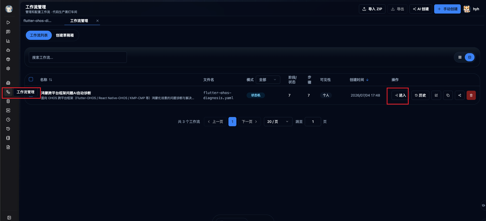
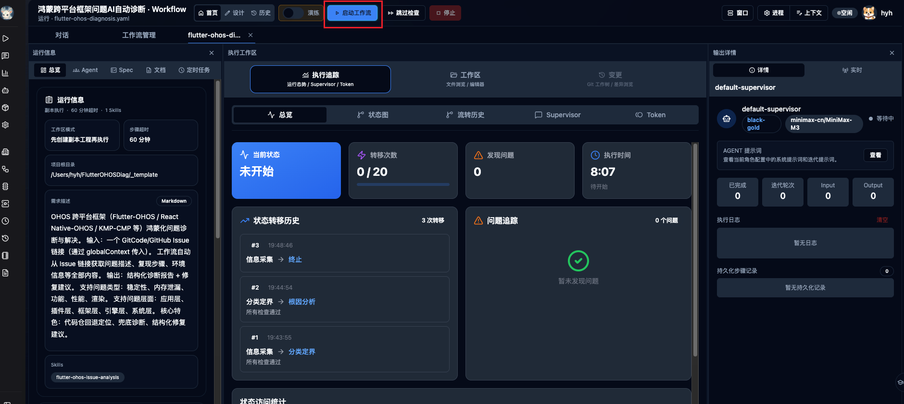
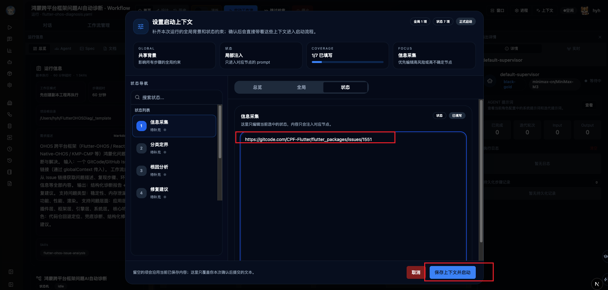
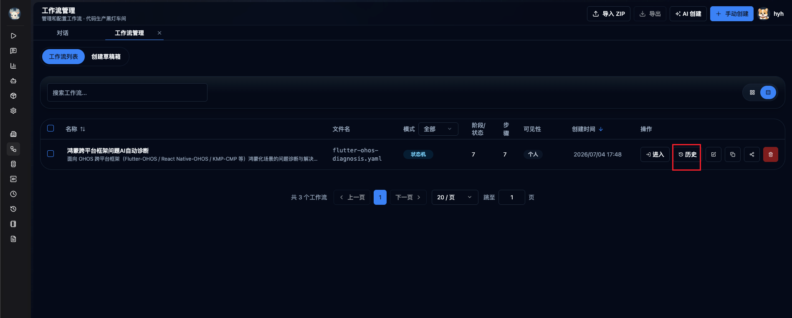
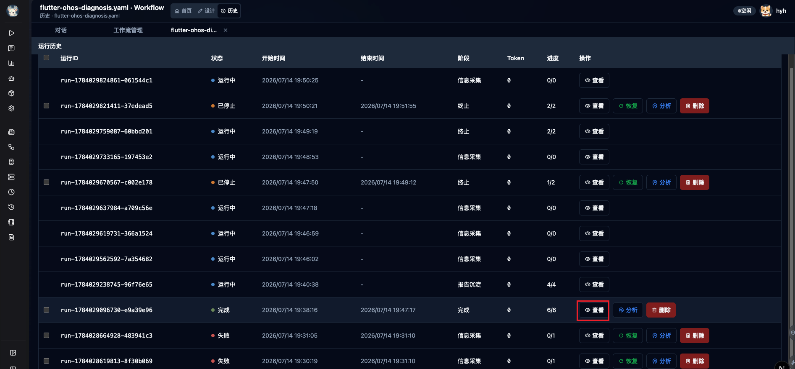
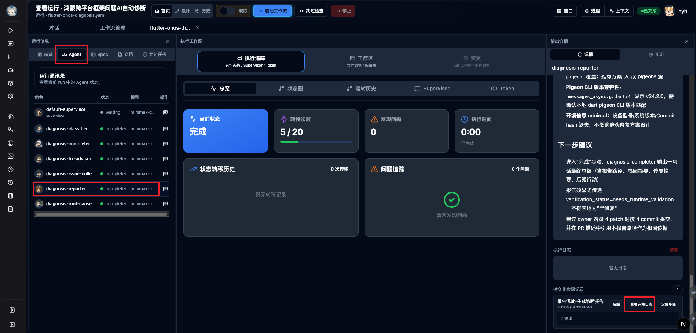

1. 访问平台网址：https://diligence-steadily-pavestone.ngrok-free.dev/
2. 注册账号
3. 选择”工作流管理“，点击”进入“工作流

4. 点击”启动工作流“

5. 输入Issue链接，点击”保存上下文并启动“

6. 点击工作流的”历史“可以查看工作流任务（通过ID不好识别，可先按创建时间来确认是哪个），点”查看“可以进去查看工作流进展

7. 完成后可点击Agent、查看完整日志来查看AI问题分析报告
