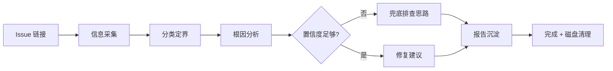
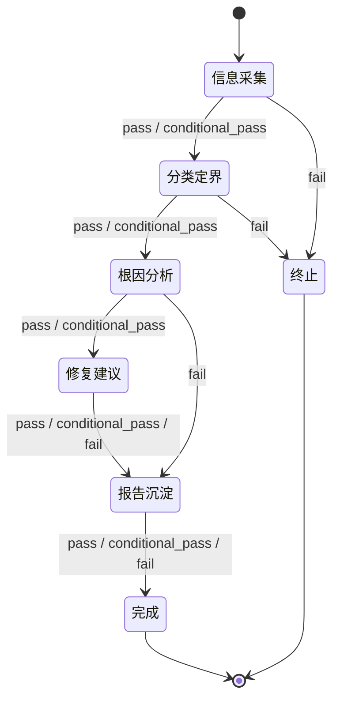

# 鸿蒙跨平台框架问题 AI 自动诊断解决工作流

> **基于 ACEHarness 的多 Agent 协作诊断系统**
>
> 参照 [ai-diagnosis-system-design.md](https://github.com/...) 设计文档实现
>
> 创建日期：2026-07-01

## 1. 系统概述

本工作流基于 ACEHarness 平台，实现面向 OHOS 跨平台框架（Flutter-OHOS / React Native-OHOS / KMP-CMP 等）鸿蒙化场景的问题诊断与解决。

> **当前实现为精简版**，去掉了问题复现、上游追踪、红蓝对抗、代码修改等环节，聚焦诊断和修复建议。完整版设计见 git 历史。

### 1.1 核心能力

| 能力 | 说明 |
|------|------|
| **精简流程** | 6 个状态：信息采集 → 分类定界 → 根因分析 → 修复建议 → 报告沉淀 → 完成 |
| **代码仓回退定位** | clone 代码仓并回退到 Issue 提出前的 merge commit，确保分析的是 Issue 提出时的代码状态 |
| **兜底诊断** | 根因置信度<0.3 时，Agent 自行输出排查思路（内联兜底逻辑） |
| **结构化修复建议** | 短期修复 + 根因修复 + 长期改进 + 上游协同（仅模板） |
| **磁盘自动清理** | 诊断完成后自动 `rm -rf repo/` 回收磁盘空间 |

### 1.2 诊断流程



## 2. 文件结构

### 2.1 Agent 配置文件

```
configs/agents/
├── diagnosis-issue-collector.yaml      # 信息采集 Agent（蓝军）
├── diagnosis-classifier.yaml           # 分类定界 Agent（蓝军）
├── diagnosis-root-cause-analyzer.yaml  # 根因分析 Agent（蓝军）
├── diagnosis-fix-advisor.yaml          # 修复建议 Agent（蓝军）
├── diagnosis-reporter.yaml             # 报告沉淀 Agent（蓝军）
├── diagnosis-completer.yaml            # 完成/终止记录 Agent（蓝军）
└── default-supervisor.yaml             # 编排 Agent（复用，黑金）
```

> 注：以下 Agent 在精简版中未使用，保留供完整版恢复：diagnosis-collector、diagnosis-upstream-tracker、diagnosis-fallback、diagnosis-reproducer、diagnosis-challenger、diagnosis-fix-challenger、diagnosis-fix-judge、diagnosis-fix-modifier、diagnosis-fix-umpire、diagnosis-fix-verifier、diagnosis-judge。

### 2.2 工作流配置

```
configs/
└── cpf-ohos-diagnosis.yaml         # 状态机工作流配置
```

### 2.3 Skill 知识源

```
skills/cpf-ohos-issue-analysis/
├── SKILL.md                            # 技能主文件（问题类型识别表、通用经验、NEVER 列表）
├── issue-types/                        # 根因模式库
│   ├── stability.md                    # 稳定性问题根因模式
│   ├── memory-leak.md                  # 内存泄漏根因模式
│   ├── functional.md                   # 功能问题根因模式
│   ├── performance.md                  # 性能问题根因模式
│   └── rendering.md                    # 渲染问题根因模式
└── references/                         # 参考文档
    ├── environment-info.md             # 环境信息采集清单
    ├── issue-content-collection.md     # Issue 内容采集指导
    ├── log-collection.md               # 日志采集命令模板
    ├── log-interpretation.md           # 日志解读方法
    ├── report-template.md              # 诊断报告模板
    └── upstream-search.md              # 上游社区搜索策略
```

## 3. Agent 角色与团队映射

| 诊断 Agent | ACEHarness 团队 | 角色定位 | 是否新建 |
|-----------|----------------|---------|---------|
| **Supervisor** | `black-gold` | 指挥官 | 复用 `default-supervisor` |
| **IssueCollector** | `blue` | 信息采集（Issue 内容 + 代码仓 clone + 回退） | ✅ 新建 |
| **Classifier** | `blue` | 分类定界（消费上游输出） | ✅ 新建 |
| **RootCauseAnalyzer** | `blue` | 根因分析（含兜底逻辑） | ✅ 新建 |
| **FixAdvisor** | `blue` | 修复建议 | ✅ 新建 |
| **Reporter** | `blue` | 报告沉淀 | ✅ 新建 |
| **Completer** | `blue` | 完成/终止记录 + 磁盘清理 | ✅ 新建 |

## 4. 状态机工作流设计

### 4.1 状态流转图



### 4.2 状态说明

| 状态 | 说明 | 人工审批 |
|------|------|---------|
| **信息采集** | Issue 内容采集 + 代码仓 clone + 回退到 Issue 提出前的 merge commit | 否 |
| **分类定界** | 消费上游输出，问题类型分类 + 层面定界 + 优先级评估 | 否 |
| **根因分析** | 综合分析定位根因，输出置信度；置信度<0.3 时内联兜底排查思路 | 否 |
| **修复建议** | 生成修复方案（短期 + 根因 + 长期 + 上游协同模板） | 否 |
| **报告沉淀** | 生成结构化诊断报告 | 否 |
| **完成** | 诊断流程完成 + 磁盘清理（rm -rf repo/） | — |
| **终止** | 异常终止 + 磁盘清理 | — |

### 4.3 verdict 枚举

工作流统一使用三种 verdict：
- `pass`：步骤成功完成
- `conditional_pass`：步骤有瑕疵但可继续（原 `skipped` 场景统一映射为此值）
- `fail`：步骤失败

> 注：`clone_result`、`reset_status`、`screenshot_analysis` 等业务字段中的 `skipped` 值是业务状态，不是 verdict，保留不变。

## 5. Skill 知识源

### 5.1 Agent 与 Skill 知识映射

| Agent | 使用的 Skill 知识 | 用途 |
|-------|-----------------|------|
| diagnosis-issue-collector | issue-content-collection.md + environment-info.md | Issue 内容采集 + 环境信息提取 |
| diagnosis-classifier | 问题类型识别表 + 层面定界参考 | 分类决策 |
| diagnosis-root-cause-analyzer | issue-types/*.md + log-interpretation.md | 根因匹配 |
| diagnosis-fix-advisor | issue-types/*.md 修复建议 | 修复方案 |
| diagnosis-reporter | report-template.md | 报告模板 |
| diagnosis-completer | 无（仅总结前序输出） | 完成/终止记录 |

### 5.2 根因模式库

| 问题类型 | 根因模式数 | 文件 |
|---------|-----------|------|
| 稳定性 | 8 | issue-types/stability.md |
| 内存泄漏 | 6 | issue-types/memory-leak.md |
| 功能 | 8 | issue-types/functional.md |
| 性能 | 6 | issue-types/performance.md |
| 渲染 | 7 | issue-types/rendering.md |

## 6. 使用方法

### 6.1 通过 ACEHarness 工作台使用

1. 打开 ACEHarness 工作台（`/workflows` 页面）
2. 选择工作流配置 `cpf-ohos-diagnosis.yaml`
3. 在 globalContext 中填入 GitCode/GitHub Issue 链接
4. 启动工作流
5. 查看诊断报告（报告沉淀阶段的输出）

### 6.2 通过 API 使用

```bash
# 创建运行
curl -X POST http://localhost:3000/api/runs \
  -H "Content-Type: application/json" \
  -d '{
    "configFile": "cpf-ohos-diagnosis.yaml",
    "configName": "鸿蒙跨平台框架问题AI自动诊断",
    "globalContext": {"issue_url": "https://gitcode.com/.../issues/123"},
    "totalSteps": 20
  }'
```

### 6.3 输入要求

- **Issue 链接**：一个 GitCode/GitHub Issue 链接（通过 globalContext 传入）
- 工作流自动从 Issue 链接获取问题描述、复现步骤、环境信息等全部内容

## 7. 降级方案

| Agent | 降级方案 | 降级后影响 |
|-------|---------|-----------|
| IssueCollector | clone 失败时标记 clone_result=skipped、verdict=conditional_pass | 根因分析只能基于 Issue 描述，无法审查代码 |
| Classifier | 默认分类为"功能问题" | 后续按通用流程排查 |
| RootCauseAnalyzer | 置信度<0.3 时内联兜底排查思路 | 输出排查思路而非确定根因 |
| FixAdvisor | 只输出短期 Workaround | 缺少根因修复建议 |
| Reporter | 输出原始分析记录 | 缺少结构化报告 |
| Completer | 磁盘清理失败不影响诊断结论 | 标注清理结果即可 |

## 8. 扩展性

### 8.1 新增问题类型

1. 在 `issue-types/` 下新增问题类型文件（如 `network.md`）
2. RootCauseAnalyzer Agent 自动加载新知识
3. Classifier Agent 自动支持新类型分类

### 8.2 新增跨平台框架

1. 在 `skills/` 下新增框架目录（如 `react-native-ohos-issue-analysis/`）
2. 编写该框架的 `issue-types/` 和 `references/`
3. Classifier Agent 自动识别框架类型并加载对应知识

### 8.3 恢复完整版流程

精简版保留了完整版的 Agent 定义（已归档），如需恢复：
1. 取消 `cpf-ohos-diagnosis.yaml` 中问题复现状态的注释
2. 恢复上游追踪、红蓝对抗、代码修改等状态
3. 参考本文档的 git 历史版本获取完整版状态机配置

## 9. 验证评估

### 9.1 准确性指标

| 指标 | 目标 |
|------|------|
| 根因准确率 | >80% |
| 类型分类准确率 | >90% |
| 层面定界准确率 | >85% |
| 修复建议可用率 | >80% |

### 9.2 有效性指标

| 指标 | 当前 | 目标 |
|------|------|------|
| 问题平均定位时间 | 4-8 小时 | <40 分钟 |
| 根因确定率 | 60% | >85% |
| 兜底诊断覆盖率 | 0% | 100% |

## 10. 相关文档

- [设计文档（原始）](../../Ai-Skill/cpf-flutter-skills/cpf-ohos-issue-analysis/docs/ai-diagnosis-system-design.md)
- [ACEHarness 工作流创建技能](../aceharness-workflow-creator/SKILL.md)
- [ACEHarness Spec Coding](../aceharness-spec-coding/SKILL.md)
- [ACEHarness 配置 README](../../configs/README.md)
