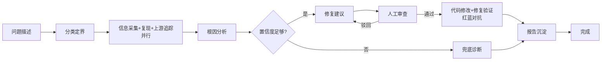
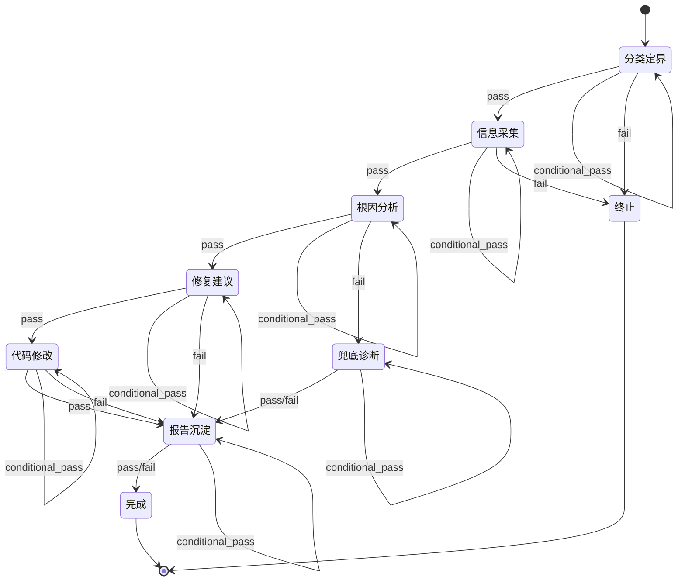

# 鸿蒙跨平台框架问题 AI 自动诊断解决工作流

> **基于 ACEHarness 的多 Agent 协作诊断系统**
>
> 参照 [ai-diagnosis-system-design.md](https://github.com/...) 设计文档实现
>
> 创建日期：2026-07-01

## 1. 系统概述

本工作流基于 ACEHarness 平台，实现面向 OHOS 跨平台框架（Flutter-OHOS / React Native-OHOS / KMP-CMP 等）鸿蒙化场景的问题诊断与解决。

### 1.1 核心能力

| 能力 | 说明 |
|------|------|
| **多 Agent 协作** | 7 个诊断 Agent + 1 个编排 Agent + 1 个兜底 Agent |
| **并行编排** | 信息采集、问题复现、上游追踪三路并行 |
| **上游社区追踪** | 自动检测共性问题、追溯引入 PR |
| **红蓝对抗验证** | FixModifier（红军）vs FixVerifier（蓝军）迭代验证 |
| **兜底诊断** | 根因无法确定时输出排查思路 |
| **知识沉淀** | 诊断经验自动沉淀到知识库 |

### 1.2 诊断流程



## 2. 文件结构

### 2.1 Agent 配置文件

```
configs/agents/
├── diagnosis-classifier.yaml           # 分类定界 Agent（蓝军）
├── diagnosis-collector.yaml            # 信息采集 Agent（蓝军）
├── diagnosis-upstream-tracker.yaml     # 上游追踪 Agent（蓝军）
├── diagnosis-root-cause-analyzer.yaml  # 根因分析 Agent（蓝军）
├── diagnosis-fix-advisor.yaml          # 修复建议 Agent（红军）
├── diagnosis-fallback.yaml             # 兜底诊断 Agent（裁判）
├── diagnosis-reporter.yaml             # 报告沉淀 Agent（裁判）
├── issue-reproducer.yaml               # 问题复现 Agent（复用，蓝军）
├── fix-developer.yaml                  # 代码修改 Agent（复用，红军）
├── fix-hunter.yaml                     # 修复验证 Agent（复用，蓝军）
├── code-hunter.yaml                    # 质疑攻击 Agent（复用，蓝军）
├── code-judge.yaml                     # 裁决 Agent（复用，裁判）
├── fix-reviewer.yaml                   # 修复审查 Agent（复用，裁判）
├── fix-judge.yaml                      # 修复裁决 Agent（复用，裁判）
├── fix-breaker.yaml                    # 修复质疑 Agent（复用，蓝军）
├── documentation-writer.yaml           # 文档生成 Agent（复用，红军）
└── default-supervisor.yaml             # 编排 Agent（复用，黑金）
```

### 2.2 工作流配置

```
configs/
└── flutter-ohos-diagnosis.yaml         # 状态机工作流配置
```

### 2.3 Skill 知识源

```
skills/flutter-ohos-issue-analysis/
├── SKILL.md                            # 技能主文件（问题类型识别表、通用经验、NEVER 列表）
├── issue-types/                        # 根因模式库
│   ├── stability.md                    # 稳定性问题根因模式（8个）
│   ├── memory-leak.md                  # 内存泄漏根因模式（6个）
│   ├── functional.md                   # 功能问题根因模式（8个）
│   ├── performance.md                  # 性能问题根因模式（6个）
│   └── rendering.md                    # 渲染问题根因模式（7个）
└── references/                         # 参考文档
    ├── environment-info.md             # 环境信息采集清单
    ├── log-collection.md               # 日志采集命令模板
    ├── log-interpretation.md           # 日志解读方法
    ├── report-template.md              # 诊断报告模板
    └── upstream-search.md              # 上游社区搜索策略
```

## 3. Agent 角色与团队映射

| 诊断 Agent | ACEHarness 团队 | 角色定位 | 是否新建 |
|-----------|----------------|---------|---------|
| **Orchestrator** | `black-gold` | 指挥官 | 复用 `default-supervisor` |
| **Classifier** | `blue` | 分类定界 | ✅ 新建 |
| **Collector** | `blue` | 信息采集 | ✅ 新建 |
| **Reproducer** | `blue` | 问题复现 | 复用 `issue-reproducer` |
| **UpstreamTracker** | `blue` | 上游追踪 | ✅ 新建 |
| **RootCauseAnalyzer** | `blue` | 根因分析 | ✅ 新建 |
| **FixAdvisor** | `red` | 修复建议 | ✅ 新建 |
| **FixModifier** | `red` | 代码修改 | 复用 `fix-developer` |
| **FixVerifier** | `blue` | 修复验证 | 复用 `fix-hunter` |
| **Reporter** | `judge` | 报告沉淀 | ✅ 新建 |
| **Fallback** | `judge` | 兜底诊断 | ✅ 新建 |

## 4. 状态机工作流设计

### 4.1 状态流转图



### 4.2 状态说明

| 状态 | 说明 | 人工审批 |
|------|------|---------|
| **分类定界** | 问题类型分类 + 层面定界 + 优先级评估 | 否 |
| **信息采集** | 并行：信息采集 + 问题复现 + 上游追踪 | 否 |
| **根因分析** | 综合分析定位根因，输出置信度 | 否 |
| **兜底诊断** | 置信度不足时输出排查思路 | 否 |
| **修复建议** | 生成修复方案 + 人工审查 | ✅ 是 |
| **代码修改** | 红蓝对抗：代码修改 + 修复验证 | 否 |
| **报告沉淀** | 生成诊断报告 + 知识沉淀 | 否 |
| **完成** | 诊断流程完成 | — |
| **终止** | 异常终止 | — |

### 4.3 并行编排

信息采集状态包含 3 个并行步骤（`parallelGroup: collect`）：

1. **信息采集**（diagnosis-collector）：采集环境信息和日志
2. **问题复现**（issue-reproducer）：建立稳定复现路径
3. **上游追踪**（diagnosis-upstream-tracker）：检测上游社区共性问题

并行执行可将诊断时间从串行的 60 分钟缩短至约 35 分钟。

## 5. Skill 知识源

### 5.1 Agent 与 Skill 知识映射

| Agent | 使用的 Skill 知识 | 用途 |
|-------|-----------------|------|
| diagnosis-classifier | 问题类型识别表 + 层面定界参考 | 分类决策 |
| diagnosis-collector | environment-info.md + log-collection.md | 采集清单 |
| diagnosis-root-cause-analyzer | issue-types/*.md + log-interpretation.md | 根因匹配 |
| diagnosis-fix-advisor | issue-types/*.md 修复建议 | 修复方案 |
| diagnosis-reporter | report-template.md | 报告模板 |
| diagnosis-fallback | 通用经验 + NEVER 列表 | 排查思路 |

### 5.2 根因模式库

| 问题类型 | 根因模式数 | 文件 |
|---------|-----------|------|
| 稳定性 | 8 | issue-types/stability.md |
| 内存泄漏 | 6 | issue-types/memory-leak.md |
| 功能 | 8 | issue-types/functional.md |
| 性能 | 6 | issue-types/performance.md |
| 渲染 | 7 | issue-types/rendering.md |

## 6. 使用方法

### 6.1 通过 ACEHarness 工作台使用

1. 打开 ACEHarness 工作台（`/workflows` 页面）
2. 选择工作流配置 `flutter-ohos-diagnosis.yaml`
3. 填写问题描述（现象、触发条件、复现步骤、环境信息）
4. 启动工作流
5. 在修复建议阶段进行人工审查
6. 查看诊断报告

### 6.2 通过 API 使用

```bash
# 创建运行
curl -X POST http://localhost:3000/api/runs \
  -H "Content-Type: application/json" \
  -d '{
    "configFile": "flutter-ohos-diagnosis.yaml",
    "configName": "鸿蒙跨平台框架问题AI自动诊断",
    "totalSteps": 20
  }'
```

### 6.3 输入要求

问题描述应包含：
- **现象**：问题表现
- **触发条件**：何时发生
- **复现步骤**：如何复现
- **环境信息**：设备型号、系统版本、框架版本
- **日志**：hilog、faultlog 等（如有）

## 7. 降级方案

| Agent | 降级方案 | 降级后影响 |
|-------|---------|-----------|
| Classifier | 默认分类为"功能问题" | 后续按通用流程排查 |
| Collector | 用已有信息继续，标记不完整 | 根因分析可能受限 |
| Reproducer | 标记为"复现不稳定" | 后续验证依赖用户手动复现 |
| UpstreamTracker | 跳过上游追踪 | 可能重复分析已解决问题 |
| RootCauseAnalyzer | 切换到 Fallback Agent | 输出排查思路而非根因 |
| FixAdvisor | 只输出短期 Workaround | 缺少根因修复建议 |
| 人工审查 | 超时未响应 | 标记"待审查"，不自动执行代码修改 |
| FixModifier | 跳过修改，标注"修复未执行" | 报告中输出人工修改指南 |
| FixVerifier | 跳过验证，标注"修复未验证" | 报告中输出修改结果供人工验证 |
| Reporter | 输出原始分析记录 | 缺少结构化报告 |

## 8. 扩展性

### 8.1 新增问题类型

1. 在 `issue-types/` 下新增问题类型文件（如 `network.md`）
2. RootCauseAnalyzer Agent 自动加载新知识
3. Classifier Agent 自动支持新类型分类

### 8.2 新增跨平台框架

1. 在 `skills/` 下新增框架目录（如 `react-native-ohos-issue-analysis/`）
2. 编写该框架的 `issue-types/` 和 `references/`
3. Classifier Agent 自动识别框架类型并加载对应知识

### 8.3 新增上游源

1. 在 UpstreamTracker Agent 的搜索策略中新增数据源
2. 自动覆盖新社区

## 9. 验证评估

### 9.1 准确性指标

| 指标 | 目标 |
|------|------|
| 根因准确率 | >80% |
| 类型分类准确率 | >90% |
| 层面定界准确率 | >85% |
| 上游追踪命中率 | >70% |
| 修复建议可用率 | >80% |
| 修复验证通过率 | >75% |

### 9.2 有效性指标

| 指标 | 当前 | 目标 |
|------|------|------|
| 问题平均定位时间 | 4-8 小时 | <40 分钟 |
| 根因确定率 | 60% | >85% |
| 上游问题复用率 | 0% | >30% |
| 兜底诊断覆盖率 | 0% | 100% |
| 新员工独立诊断率 | <20% | >70% |

## 10. 相关文档

- [设计文档（原始）](../../Ai-Skill/cpf-flutter-skills/flutter-ohos-issue-analysis/docs/ai-diagnosis-system-design.md)
- [ACEHarness 工作流创建技能](../aceharness-workflow-creator/SKILL.md)
- [ACEHarness Spec Coding](../aceharness-spec-coding/SKILL.md)
- [ACEHarness 配置 README](../../configs/README.md)
