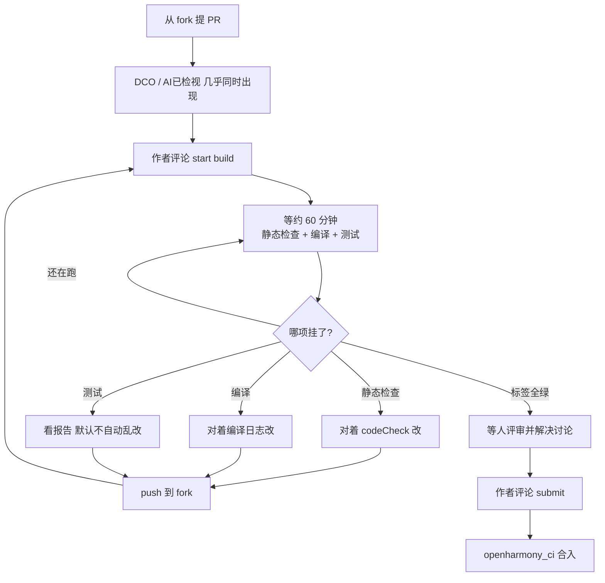
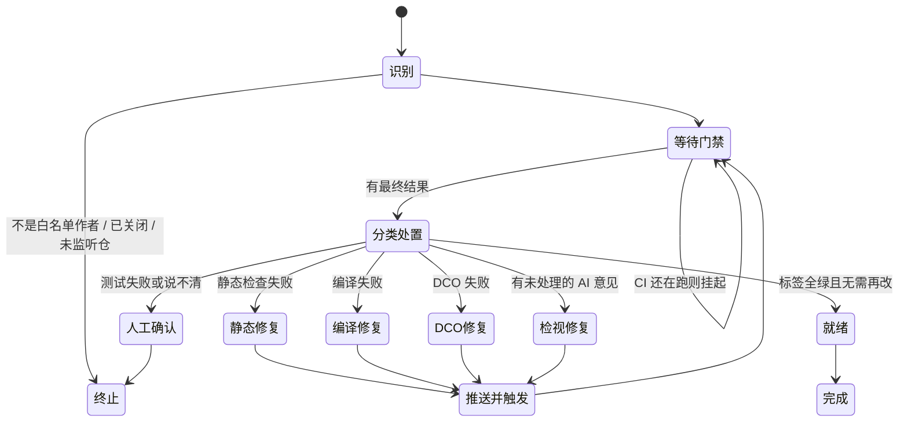

# GitCode 自己的 PR 自修 — 设计方案

工作流配置：`configs/gitcode-pr-review.yaml`  
技能：`skills/gitcode-pr-review/`  
对照仓：[CPF-Flutter/flutter_flutter](https://gitcode.com/CPF-Flutter/flutter_flutter)  
对照合入记录：[#1900](https://gitcode.com/CPF-Flutter/flutter_flutter/merge_requests/1900) 及 [最近已合并 PR](https://gitcode.com/CPF-Flutter/flutter_flutter/pulls?state=merged)

创建日期：2026-09-01

本文是目标设计。仓库里的 YAML / Skill / Webhook 已按本文落地循环状态机（等待 → 分类 → 修 → 推并 `start build` → 再等）。引擎按 PR 并行锁仍未改，不同 PR 同时跑仍会 409。

---

## 1. 要解决什么

在约 30 人共同维护的 GitCode 仓上，只帮 **作者白名单里的人** 修自己的 PR：

1. GitCode Webhook 打到 ACEHarness
2. 不是白名单作者 / 未监听的仓 / 已关闭 → 忽略，不开工作流
3. 看 OpenHarmony DCP 门禁（标签 + `openharmony_ci` 评论），不是 GitHub commit status
4. 按失败类型修：静态检查 / 编译 / DCO / AI 检视
5. commit（带 DCO）并 push 到 **fork 的 head 分支**
6. 在 PR 上评论 `start build`，再回去等门禁
7. 全绿后通知人，**不自动 `submit`、不合入**

---

## 2. 明确不做

| 不做 | 原因 |
|------|------|
| 处理他人 PR | 这是自修，不是全仓机器人 |
| 自动评论 `submit` / 点合入 | 作者不能自己合；要评审人 + `openharmony_ci` |
| 测试 / 冒烟失败时自动改代码 | 报告难读，误改风险高，默认停下来问人 |
| 用 Agent 空转「等 60 分钟」 | 应挂起，等下一次 Webhook / 标签叫醒 |
| 在步骤里编 Flutter/OH 全量工程 | 真伪以 DCP 为准 |
| 把 `works` 探测 PR 当成已验证 | 那个 PR 没有 DCP、没有 fork、没有 `start build` |

---

## 3. 这个仓真实的 PR 过程

以 [#1900](https://gitcode.com/CPF-Flutter/flutter_flutter/merge_requests/1900) 为准。源码在个人 fork，目标分支 `oh-3.44.9-dev`。合入人是 `openharmony_ci`，不是作者。作者不能自己合（`disable_merge_by_self`），需要至少 1 名评审批准，讨论必须解决。



门禁不走 `GET /repos/.../commits/{sha}/status`（该接口在本仓 404）。结果在：

- 标签：`dco检查成功/失败`、`静态检查成功/失败`、`编译成功/失败`、`冒烟测试成功/失败`、`AI已检视`
- PR 评论：作者 `start build` / `submit`；`openharmony_ci` 回复构建开始、未通过、通过，并带 DCP 报告链接

#1900 第一次失败是 **静态检查 noPass**，编译当时还是 pending。因此不能把所有失败都丢进「编译修复」。

机器要跟的是 **C → D → E → 改 → I → 再回到 C**。提 PR、`submit`、合入留给人。

---

## 4. 这个仓每天 / 每周有多少 PR

对照仓 [CPF-Flutter/flutter_flutter](https://gitcode.com/CPF-Flutter/flutter_flutter)，统计日 2026-09-01（北京时间）。接口：

```
GET https://gitcode.com/api/v5/repos/CPF-Flutter/flutter_flutter/pulls?only_count=true
```

两套口径不要混：

| 口径 | 筛的字段 | 含义 | 自修更该看谁 |
|------|----------|------|----------------|
| 创建 / 提交 | `created_after` / `created_before`，`state=all` | 当天新开了多少条（后来合入、关掉、仍开着都算） | **看这个**。Webhook 和自修是 PR 开出来之后开始跟 |
| 合入 | `merged_after` / `merged_before`，`state=merged` | 当天真正合进去多少条 | 吞吐，不是当天负载 |

同一条 PR 可能周一开、周三才合，两套日期对不上。例如 [#1900](https://gitcode.com/CPF-Flutter/flutter_flutter/merge_requests/1900) 8/31 创建、9/1 15:41 合入：创建算 8/31，合入算 9/1。

当时仓上累计已合并 1529，开启中 45，已关闭未合 291。下面是全仓量。自修只处理 `ACE_GITCODE_PR_AUTHOR` 白名单，实际 run 数会小一截；全仓数字用来估 Webhook 噪声、以及引擎锁改完之后并行上限别按「一天一两单」来想。

**按创建（估负载）**：工作日大约每天新开 8–10 个，完整一周大约 45–50 个。  
**按合入（估吞吐）**：工作日大约每天合入 5–8 个，完整一周大约 35–45 个。  
周日几乎为 0。忙的一天能新开 20+（2026-08-20 开了 26 个），淡的一周个位数合入（2026-08-10～16 只合了 7 个）。

8 月按创建是 208，按合入是 143：当月新开的里有 54 条关掉未合、16 条到统计日还开着，再加上跨月合入，所以两套对不上。

### 4.1 按创建时间

`only_count` 返回 `all` / `merged` / `opened` / `closed`。`merged` 是这些新开 PR **后来**合进去了多少，不是当天合入数。9/1 和本周（8/31～9/6）未完。

近 12 周：

| 周（周一～周日） | 新开 | 后来已合入 | 仍开着 | 关掉未合 |
|------------------|------|------------|--------|----------|
| 6/15–6/21 | 21 | 19 | 0 | 2 |
| 6/22–6/28 | 50 | 41 | 0 | 9 |
| 6/29–7/5 | 65 | 57 | 4 | 4 |
| 7/6–7/12 | 57 | 51 | 3 | 3 |
| 7/13–7/19 | 36 | 31 | 2 | 3 |
| 7/20–7/26 | 42 | 34 | 1 | 7 |
| 7/27–8/2 | 44 | 38 | 0 | 6 |
| 8/3–8/9 | 43 | 37 | 0 | 6 |
| 8/10–8/16 | 30 | 18 | 4 | 8 |
| 8/17–8/23 | 70 | 44 | 0 | 26 |
| 8/24–8/30 | 51 | 34 | 4 | 13 |
| 8/31–9/6（未完） | 23 | 2 | 17 | 4 |

11 个完整周合计 509，平均 46/周，中位数 44/周。

8 月整月新开 208（138 已合入、16 仍开、54 关掉未合）。工作日 177 条，约每天 8.4 个。周日全是 0。

| 日期 | 周几 | 新开 | 已合入 | 仍开着 | 关掉 |
|------|------|------|--------|--------|------|
| 8/1 | 六 | 3 | 3 | 0 | 0 |
| 8/2 | 日 | 0 | 0 | 0 | 0 |
| 8/3 | 一 | 5 | 5 | 0 | 0 |
| 8/4 | 二 | 7 | 4 | 0 | 3 |
| 8/5 | 三 | 2 | 2 | 0 | 0 |
| 8/6 | 四 | 10 | 9 | 0 | 1 |
| 8/7 | 五 | 11 | 9 | 0 | 2 |
| 8/8 | 六 | 8 | 8 | 0 | 0 |
| 8/9 | 日 | 0 | 0 | 0 | 0 |
| 8/10 | 一 | 3 | 2 | 0 | 1 |
| 8/11 | 二 | 3 | 2 | 0 | 1 |
| 8/12 | 三 | 13 | 6 | 3 | 4 |
| 8/13 | 四 | 4 | 3 | 0 | 1 |
| 8/14 | 五 | 2 | 0 | 1 | 1 |
| 8/15 | 六 | 5 | 5 | 0 | 0 |
| 8/16 | 日 | 0 | 0 | 0 | 0 |
| 8/17 | 一 | 18 | 9 | 0 | 9 |
| 8/18 | 二 | 4 | 3 | 0 | 1 |
| 8/19 | 三 | 15 | 12 | 0 | 3 |
| 8/20 | 四 | 26 | 17 | 0 | 9 |
| 8/21 | 五 | 4 | 3 | 0 | 1 |
| 8/22 | 六 | 3 | 0 | 0 | 3 |
| 8/23 | 日 | 0 | 0 | 0 | 0 |
| 8/24 | 一 | 4 | 1 | 0 | 3 |
| 8/25 | 二 | 4 | 4 | 0 | 0 |
| 8/26 | 三 | 15 | 7 | 1 | 7 |
| 8/27 | 四 | 8 | 6 | 2 | 0 |
| 8/28 | 五 | 8 | 4 | 1 | 3 |
| 8/29 | 六 | 12 | 12 | 0 | 0 |
| 8/30 | 日 | 0 | 0 | 0 | 0 |
| 8/31 | 一 | 11 | 2 | 8 | 1 |
| 9/1（统计当日，未完） | 二 | 12 | 0 | 9 | 3 |

近半年按月：

| 月 | 新开 | 后来已合入 | 仍开着 | 关掉未合 |
|----|------|------------|--------|----------|
| 2026-03 | 84 | 72 | 0 | 12 |
| 2026-04 | 110 | 91 | 2 | 17 |
| 2026-05 | 164 | 130 | 2 | 32 |
| 2026-06 | 182 | 155 | 3 | 24 |
| 2026-07 | 217 | 184 | 10 | 23 |
| 2026-08 | 208 | 138 | 16 | 54 |
| 2026-09（1 号当天） | 12 | 0 | 9 | 3 |

### 4.2 按合入时间

只计 `state=merged`。列表页：[最近已合并](https://gitcode.com/CPF-Flutter/flutter_flutter/pulls?state=merged)。

近 12 周：

| 周（周一～周日） | 合入数 |
|------------------|--------|
| 6/15–6/21 | 16 |
| 6/22–6/28 | 33 |
| 6/29–7/5 | 64 |
| 7/6–7/12 | 48 |
| 7/13–7/19 | 36 |
| 7/20–7/26 | 31 |
| 7/27–8/2 | 48 |
| 8/3–8/9 | 39 |
| 8/10–8/16 | 7 |
| 8/17–8/23 | 43 |
| 8/24–8/30 | 45 |
| 8/31–9/6（未完） | 9 |

11 个完整周合计 410，平均 37/周，中位数 39/周。去掉 16 和 7 两个极端后约 43/周。

8 月整月合入 143（含周末约 4.6/天；21 个工作日 114 条，约每天 5.4 个）。周日连续为 0。高峰：8/8（周六 14）、8/19（12）、8/20（15）、8/25（11）、8/29（周六 12）。

| 日期 | 周几 | 合入 |
|------|------|------|
| 8/1 | 六 | 1 |
| 8/2 | 日 | 0 |
| 8/3 | 一 | 9 |
| 8/4 | 二 | 4 |
| 8/5 | 三 | 4 |
| 8/6 | 四 | 3 |
| 8/7 | 五 | 5 |
| 8/8 | 六 | 14 |
| 8/9 | 日 | 0 |
| 8/10 | 一 | 4 |
| 8/11 | 二 | 1 |
| 8/12 | 三 | 0 |
| 8/13 | 四 | 2 |
| 8/14 | 五 | 0 |
| 8/15 | 六 | 0 |
| 8/16 | 日 | 0 |
| 8/17 | 一 | 4 |
| 8/18 | 二 | 2 |
| 8/19 | 三 | 12 |
| 8/20 | 四 | 15 |
| 8/21 | 五 | 8 |
| 8/22 | 六 | 2 |
| 8/23 | 日 | 0 |
| 8/24 | 一 | 5 |
| 8/25 | 二 | 11 |
| 8/26 | 三 | 4 |
| 8/27 | 四 | 8 |
| 8/28 | 五 | 5 |
| 8/29 | 六 | 12 |
| 8/30 | 日 | 0 |
| 8/31 | 一 | 8 |
| 9/1（统计当日，未完） | 二 | 1 |

近半年按月：

| 月 | 合入数 |
|----|--------|
| 2026-03 | 76 |
| 2026-04 | 93 |
| 2026-05 | 123 |
| 2026-06 | 139 |
| 2026-07 | 204 |
| 2026-08 | 143 |
| 2026-09（1 号当天） | 1 |

3 月到 7 月在爬升，7 月最高，8 月回到和 6 月差不多。

### 4.3 对自修设计的含义

1. 估机器一天会碰到多少新 PR，用 **创建量**：工作日 8–10 个全仓新开。白名单是约 30 人里的子集，自修 run 会更少，但不要按「偶尔一条」设计等待和锁。
2. 合入量不能当负载。门禁一轮约 60 分钟，一条 PR 从开到合往往跨天，工作日同时开着的不只有当天新开的那 8–10 条（统计日开启中 45）。
3. 引擎支持同一 yaml 多 run 并行（每 run 独立 manager 与工作区）：webhook 按 PR 身份精确匹配唤醒，未匹配且未达 `ACE_GITCODE_MAX_PARALLEL`（默认 3）就新起 run，白名单作者多条开着的 PR 可同时自修。
4. 周日基本没有新开和合入。Webhook 过滤（非白名单 / 已关 / 已合）必须便宜，因为 GitCode 会对仓里每一次 MR 事件都 POST，噪声按全仓 8–10 个/工作日计，不是按白名单计。

---

## 5. 为什么是循环，不是四段直线

现有 YAML 假设：

门禁检查 → 编译修复 → 检视修复 → 重新提交 → 完成

真实过程里静态检查、编译、测试、DCO、AI 意见会交错出现，一轮修复后必须再 `start build`、再等。所以状态机必须能回到「等待门禁」，不能推完就结束。



---

## 6. 各状态

### 6.1 识别

从 Webhook 或 PR 链接解析，禁止编造号。

必须记下：

- `owner` / `repo` / `number`（上游仓，如 `CPF-Flutter/flutter_flutter`）
- `author`
- `head.ref`
- **`head.repo`（fork 全名）**，例如 `zhong_ning/flutter_flutter_5186_zhawei_multiple_window_bugfix`
- `base.ref`（如 `oh-3.44.9-dev`）

不是白名单作者、不在仓库白名单、已关闭/已合入 → 终止，不改代码。

Webhook 解析必须兼容 GitCode 真实 payload（`merge_request` + `project.full_path` + 从 `web_url` 拆 owner/repo/number + `user.username`），不能只认 GitHub 的 `pull_request` / `user.login`。

### 6.2 等待门禁

读 PR 标签 + 最新 `openharmony_ci` 评论，产出 `outputs/gate-check.json`。

| 判定 | verdict | 行为 |
|------|---------|------|
| 评论写着构建开始、编译/测试仍 pending | `conditional_pass` | **挂起**，等下一次 Webhook |
| 静态检查 / 编译 / DCO / 测试已有失败结论 | `pass`（交给分类） | 进入分类处置 |
| 相关成功标签齐全 | `pass` | 进入分类处置 |
| 超过约 90 分钟仍 pending | `conditional_pass` 或超时醒一次 | 再拉一次评论，不要 Agent 空转 3 轮 |

不要用三个 Agent 把「等待」跑成三次立刻结束的自循环。

### 6.3 分类处置

尽量脚本判定，少让模型猜。多项同时失败时只修一类，优先级：

**DCO → 静态检查 → 编译 → AI 检视 → 测试（默认人工）**

| `phase` | 去向 |
|---------|------|
| `dco_failed` | DCO修复 |
| `static_failed` | 静态修复 |
| `compile_failed` | 编译修复 |
| `ai_review_pending` | 检视修复 |
| `test_failed` | 人工确认 |
| `green` 且工作区无改动 | 就绪 |
| `green` 但有未推改动 | 推送并触发 |
| `running` | 回到等待门禁 |
| `unknown` | 人工确认或继续等，禁止假装通过 |

### 6.4 修复状态（静态 / 编译 / DCO / 检视）

共同规则：

- checkout **fork** 的 `head_ref` 到 `repo/`；已有则 fetch，不要每次全量 clone
- 本状态不 `git commit` / `git push`
- 修不好则 `conditional_pass`，写清缺哪份 DCP 日志
- 连续同一 `phase` 失败超过 3 轮 → 终止

分工：

- **静态修复**：对着 codeCheck / 静态检查报告改
- **编译修复**：对着 DCP 编译失败日志改
- **DCO修复**：只补 `Signed-off-by: Name <email>`，不改业务代码
- **检视修复**：跑 `fetch-ai-review.mjs`；`actionable_count=0`（包括只有 `AI已检视` 标签、没有意见正文）则不要空改；有意见则按 `path/line` 改

测试失败不进自动修复。

### 6.5 推送并触发

1. `git status` 无改动 → 不要空 commit，也不要空评论 `start build`，回到等待或就绪
2. 有改动：`git diff` 写入 `outputs/fix.patch`
3. commit 信息写清修的是静态 / 编译 / DCO / 检视
4. commit **必须带 DCO**
5. push 到 **fork remote 的 `head_ref`**，禁止 `--force`
6. 用 GitCode API 在该 PR 上评论恰好一行：`start build`
7. 回到 **等待门禁**

### 6.6 就绪 / 完成

标签齐。写摘要：PR 链接、门禁状态、改了什么、是否已 `start build`。  
写明：未 `submit`、未合入。通知人去评审、解讨论、自己评论 `submit`。

### 6.7 人工确认 / 终止

测试失败、报告打不开、推送无权限等到这里。终止原因必须可核对（他人 PR / 已关 / 测试失败 / 轮次用尽）。

---

## 7. 谁会被开工作流

GitCode 会对仓里 **每一次** MR 开/更新/评论都 POST 到 Webhook。ACEHarness 先过滤，再决定开不开 run。

| 条件 | 行为 |
|------|------|
| 作者不在 `ACE_GITCODE_PR_AUTHOR` | 202 忽略，不开 run |
| 仓不在 `ACE_GITCODE_WATCH_REPOS`（若配置了） | 忽略 |
| 已关闭 / 已合入 | 忽略 |
| 白名单作者、PR 仍开、当前无该 PR 的自修 | **开一条** |
| 同一条 PR 已有自修在跑 | **不开第二条**，把新事件交给现有 run（叫醒「等待门禁」） |

`ACE_GITCODE_PR_AUTHOR` 可写多个，逗号分隔，例如 `z2036709353,another_user`。  
`ACE_GITCODE_WATCH_REPOS` 正式环境应为 `CPF-Flutter/flutter_flutter`，不要长期用测试仓 `z2036709353/works`。

---

## 8. 并行：现在不行，设计要按 PR 锁

### 8.1 现状（引擎限制）

`POST /api/workflow/start` 按 **配置文件** 上锁：`gitcode-pr-review.yaml` 同一时刻只能有一条 `running`。第二条（另一用户、另一条 PR、或同一 PR 的第二次 Webhook）返回 **409「该配置的工作流已在运行中」**。

因此现在即使白名单有多人，也是 **全仓共用一条自修流水线**。

### 8.2 目标

锁的粒度改成 `configFile + owner + repo + number`：

- **同一条 PR**：始终一个 run；CI 评论只唤醒，不新开
- **不同 PR / 不同白名单作者**：允许并行

未改启动接口之前，不要假设能并行。改 YAML 解决不了这把锁。

Webhook 侧伪代码：

```
if (not whitelist author) return ignore
if (not watched repo) return ignore
if (pr closed or merged) return ignore
existing = findRunning(configFile, owner, repo, number)
if (existing) wake(existing, payload); return
if (same configFile running other PRs && engine still config-locked) return 409
start new run
```

---

## 9. 门禁数据契约

`outputs/gate-check.json` 目标形状：

```json
{
  "verdict": "pass | conditional_pass | fail",
  "phase": "running | static_failed | compile_failed | test_failed | dco_failed | ai_review_pending | green | unknown",
  "pr_url": "https://gitcode.com/CPF-Flutter/flutter_flutter/merge_requests/1900",
  "author": "zhong_ning",
  "head_repo": "zhong_ning/flutter_flutter_xxx",
  "head_ref": "pr1881-split-b",
  "base_ref": "oh-3.44.9-dev",
  "labels": ["静态检查失败", "编译成功"],
  "latest_ci_comment": "",
  "report_url": "http://dcp.openharmony.cn/workbench/cicd/detail/.../runlist",
  "own_pr": true,
  "closed": false
}
```

禁止再把「commit status 404」解释成门禁通过。

---

## 10. 脚本与配置

| 文件 | 职责 |
|------|------|
| `skills/gitcode-pr-review/scripts/check-pr-gates.mjs` | 改读标签 + CI 评论，输出上一节 JSON；不再依赖 `/commits/{sha}/status` |
| `skills/gitcode-pr-review/scripts/fetch-ai-review.mjs` | 继续拉 diff/issue/review 评论；仅有标签无正文 → 无需改 |
| `skills/gitcode-pr-review/scripts/post-pr-comment.mjs` | **新增**，发 `start build`（需要 `GITCODE_TOKEN`） |
| `skills/gitcode-pr-review/SKILL.md` | 按循环过程改步骤 |
| `configs/gitcode-pr-review.yaml` | 状态改为本文第 6 节 |
| `src/lib/workflow/pr-review-input.ts` | 保持 GitCode payload 解析（merge_request / username / URL 回退） |
| `src/lib/workflow/gitcode-webhook.ts` | 同 PR 去重；过滤白名单 |
| `src/app/api/workflow/start/route.ts` | 并行所需：锁从「整个 yaml」改为「yaml + PR」 |

运行时 YAML / skill 在 `%APPDATA%\ACEHarness\`。改仓库后要拷到 AppData，dev 不会自动覆盖已有文件。

环境变量：

| 变量 | 含义 |
|------|------|
| `ACE_GITCODE_WEBHOOK_SECRET` | Webhook 共享密钥，URL 上 `?password=` |
| `ACE_GITCODE_PR_AUTHOR` | 作者白名单 |
| `ACE_GITCODE_WATCH_REPOS` | 仓白名单，正式为 `CPF-Flutter/flutter_flutter` |
| `ACE_GITCODE_START_BUILD_MAX` | 同一代码版本 `start build` 重试上限，默认 3；DCP 门禁对同一代码存在抖动，静态/编译失败且预算未用完时 phase=need_start_build 直接重发，新 push 重置预算 |
| `GITCODE_TOKEN_{用户名}` | 该 GitCode 用户自己的密钥；评论 `start build`、HTTPS push 必须用对应人的，不能互相覆盖 |
| `GITCODE_TOKEN` / `ACE_GITCODE_TOKEN` | 未匹配到具体人时的只读回退 |
| `ACE_INTERNAL_BASE_URL` | 本机 `http://127.0.0.1:3000`，供 Webhook 内调 start |

Webhook URL：

`{公网 origin}/api/gitcode/webhook?password={ACE_GITCODE_WEBHOOK_SECRET}`

事件至少勾 **Merge Request** 和 **Note**。

---

## 11. 和现有实现的差距

| 现有 | 目标 |
|------|------|
| 门禁 = commit status | 标签 + `openharmony_ci` 评论 |
| 失败一律进编译修复 | 按 phase 分流 |
| 推 `origin head_ref` | 推 fork `head.repo` |
| 推完结束 | 评论 `start build` 后回到等待 |
| 无 DCO | commit 必须 Signed-off-by |
| `maxSelfTransitions: 3` 空等 CI | 挂起等 Webhook |
| 同一 yaml 一把锁 | 同一 PR 一把锁，不同 PR 可并行（`ACE_GITCODE_MAX_PARALLEL`，默认 3） |
| 探测仓 `z2036709353/works` | 正式听 `CPF-Flutter/flutter_flutter` |

`works` 上已验证的只有：Webhook 能打到本机、密码校验、作者过滤、GitCode payload 能解析并 **拉起** 流水线。门禁分类、fork push、`start build`、循环等待 **都未验证**。

---

## 12. 落地顺序

1. 重写 `check-pr-gates.mjs` + YAML 循环（等待 → 分类 → 修 → 推并 `start build` → 再等）
2. fork remote + DCO + `post-pr-comment.mjs`
3. Webhook 同 PR 去重（先在 gitcode-webhook 层查 running run，引擎锁未改前仍可能 409）
4. 启动接口改为按 PR 加锁，才允许白名单用户并行
5. 用白名单账号在 `flutter_flutter` 上的真实 PR 打通，不要再用无门禁的探测 PR 当验收

---

## 13. 验收

- 非白名单作者提 PR：有 POST，无新 run
- 白名单作者提 PR：开一条「GitCode 自己的 PR 自修」
- 同一 PR 的 `start build` / CI 评论：不新开第二条（引擎改完后应唤醒等待中的 run）
- 静态检查失败进入静态修复，而不是编译修复
- push 目标是 fork，commit 含 `Signed-off-by`
- 推送成功后 PR 上出现评论 `start build`
- 全绿后摘要不写「已合入」，且没有自动 `submit`
- 在启动锁改完之前：第二份并发 PR 仍 409，文档与现象一致
