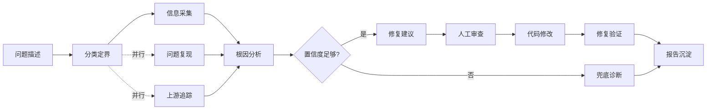

# CPF 鸿蒙跨平台框架问题 AI 诊断技能

## 技能定位

本技能是「鸿蒙跨平台框架问题 AI 自动诊断工作流」的**知识源**，为诊断 Agent 提供领域专家经验。

> **三层职责划分**：Agent 的执行步骤由 Workflow（调度）+ Agent 自身（角色+工具）+ Skill（领域知识）三者共同确定。本 Skill 只提供领域知识，不定义执行步骤。

## 问题类型识别表

| 问题类型 | 关键特征 | 典型现象 | 优先级参考 |
|---------|---------|---------|-----------|
| **稳定性 (stability)** | 进程崩溃/退出、ANR 卡死 | 闪退、冻结、SIGABRT/SIGSEGV | P0-P1 |
| **内存泄漏 (memory-leak)** | 内存持续增长、OOM | 长时间运行后卡顿/崩溃 | P1-P2 |
| **功能 (functional)** | 功能不工作、行为异常 | MissingPluginException、API 不响应 | P1-P2 |
| **性能 (performance)** | 卡顿、掉帧、启动慢 | FPS<60、启动>3s | P2-P3 |
| **渲染 (rendering)** | UI 显示异常 | 黑屏、白屏、花屏、错位 | P0-P2 |

## 问题层面定界参考

| 层面 | 占比 | 检查重点 |
|------|------|---------|
| **应用层** | 60% | 用户代码逻辑、状态管理、生命周期处理 |
| **插件层** | 25% | 插件鸿蒙化实现、MethodChannel 通信、权限声明 |
| **框架层** | 10% | Flutter framework 鸿蒙化代码、平台差异处理 |
| **引擎层** | 4% | Engine/Embedder、完整堆栈、提 Issue |
| **系统层** | 1% | HarmonyOS 系统行为、版本差异对比 |

## 诊断流程总览



## 知识源文件索引

### 根因模式库（issue-types/）

| 文件 | 问题类型 | 根因模式数 |
|------|---------|-----------|
| [issue-types/stability.md](./issue-types/stability.md) | 稳定性 | 8+ |
| [issue-types/memory-leak.md](./issue-types/memory-leak.md) | 内存泄漏 | 6+ |
| [issue-types/functional.md](./issue-types/functional.md) | 功能 | 8+ |
| [issue-types/performance.md](./issue-types/performance.md) | 性能 | 6+ |
| [issue-types/rendering.md](./issue-types/rendering.md) | 渲染 | 7+ |

### 参考文档（references/）

| 文件 | 内容 |
|------|------|
| [references/common-experience.md](./references/common-experience.md) | 通用经验 + NEVER 列表 + 通用工具约束 |
| [references/issue-content-collection.md](./references/issue-content-collection.md) | Issue 正文 API（先于网页）+ 评论 + 截图降级 |
| [references/environment-info.md](./references/environment-info.md) | 环境信息采集清单 |
| [references/log-collection.md](./references/log-collection.md) | 日志采集命令模板 |
| [references/log-interpretation.md](./references/log-interpretation.md) | 日志解读方法 |
| [references/fix-strategy.md](./references/fix-strategy.md) | OHOS 独有问题修复策略 + SDK/repo 必须同套 + embedding HAR 如何进 Demo |
| [references/report-template.md](./references/report-template.md) | 诊断报告模板 |
| [references/upstream-search.md](./references/upstream-search.md) | 上游社区搜索策略 |
| [references/ohos-signing-config.md](./references/ohos-signing-config.md) | OHOS 签名配置 |

## Agent 与 Skill 知识映射

> 映射表对齐当前工作流（cpf-ohos-diagnosis.yaml）实际引用的 8 个 Agent。分类定界已合并到根因分析 Agent，不再有独立的 classifier。

| Agent | 使用的 Skill 知识 | 用途 |
|-------|-----------------|------|
| **diagnosis-issue-collector** | references/issue-content-collection.md + references/environment-info.md | Issue 内容采集 + 环境信息采集 |
| **diagnosis-root-cause-analyzer** | 问题类型识别表 + 层面定界参考 + issue-types/*.md + references/log-interpretation.md | 分类定界 + 根因匹配 + 置信度评估 |
| **diagnosis-challenger** | SKILL.md（问题类型识别表）+ issue-types/*.md | 质疑根因假设、挑战证据链 |
| **diagnosis-judge** | SKILL.md（问题类型识别表、层面定界参考）+ issue-types/*.md | 裁决 defender 与 attacker 的结论 |
| **diagnosis-fix-advisor** | issue-types/*.md 修复建议 + references/fix-strategy.md | 修复方案设计 + OHOS Native 优先策略 |
| **diagnosis-fix-verifier-advisor** | issue-types/*.md + references/fix-strategy.md（含 SDK/repo 同套 + embedding HAR）+ 本 Skill 的 SKILL.md | 对抗验证修复方案 + Native 优先策略检查 + 引擎对齐 + 换对 Demo 实际消费的 HAR |
| **diagnosis-reporter** | references/report-template.md | 诊断报告模板 |
| **diagnosis-completer** | 通用经验 + NEVER 列表 | 最终总结 + 磁盘清理 |

## 通用经验与约束

跨 Agent 的通用经验、NEVER 列表和通用工具约束已提取到独立文件：[references/common-experience.md](./references/common-experience.md)

各 Agent 的 systemPrompt 不必重复声明这些内容，只需在需要时引用本文件。主要包含：

- **10 条通用经验**：上游优先、渐进式深入、对比分析法、最小复现法、日志先行、GitCode 获取锁定降级链、证据分级表达、报告保守表述、步骤结论可传递、缺失证据要写影响
- **16 条 NEVER 列表**：避免常见诊断错误的硬禁止（含 embedding 勿默认盖 `flutter.har`、SDK/repo 必须同套、禁止修订黄金标志再 pass、GitCode 禁止抓页/猜乱码）
- **通用工具约束**：不要调用 write/edit、不要读取 ACEHarness 内部状态、不要搜索上游仓库、必须输出 step-conclusion 标签等

## 多框架扩展

本技能当前聚焦 Flutter-OHOS（CPF 版），架构支持按框架扩展：

```
cpf-ohos-issue-analysis/           # 当前（CPF 鸿蒙跨平台框架）
├── issue-types/
└── references/

react-native-ohos-issue-analysis/  # 可扩展（RN-OHOS）
├── issue-types/
└── references/

kmp-cmp-issue-analysis/            # 可扩展（KMP-CMP）
├── issue-types/
└── references/
```

框架扩展流程：
1. 在 `skills/` 下新增框架目录
2. 编写该框架的 `issue-types/` 和 `references/`
3. 根因分析 Agent（含分类定界）自动识别框架类型并加载对应知识
4. 其他 Agent 无需修改，自动使用新框架知识
