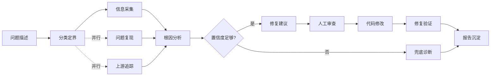

# Flutter-OHOS 问题 AI 诊断技能

## 技能定位

本技能是「鸿蒙跨平台框架问题 AI 自动诊断工作流」的**知识源**，为诊断 Agent 提供领域专家经验。

> **三层职责划分**：Agent 的执行步骤由 Workflow（调度）+ Agent 自身（角色+工具）+ Skill（领域知识）三者共同确定。本 Skill 只提供领域知识，不定义执行步骤。

## 问题类型识别表

| 问题类型 | 关键特征 | 典型现象 | 优先级参考 |
|---------|---------|---------|-----------|
| **稳定性 (stability)** | 进程崩溃/退出、ANR 卡死 | 闪退、冻结、SIGABRT/SIGSEGV | P0-P1 |
| **内存泄漏 (memory-leak)** | 内存持续增长、OOM | 长时间运行后卡顿/崩溃 | P1-P2 |
| **功能 (functional)** | 功能不工作、行为异常 | MissingPluginException、API 不响应 | P1-P2 |
| **性能 (performance)** | 卡顿、掉帧、启动慢 | FPS<60、启动>3s | P2-P3 |
| **渲染 (rendering)** | UI 显示异常 | 黑屏、白屏、花屏、错位 | P0-P2 |

## 问题层面定界参考

| 层面 | 占比 | 检查重点 |
|------|------|---------|
| **应用层** | 60% | 用户代码逻辑、状态管理、生命周期处理 |
| **插件层** | 25% | 插件鸿蒙化实现、MethodChannel 通信、权限声明 |
| **框架层** | 10% | Flutter framework 鸿蒙化代码、平台差异处理 |
| **引擎层** | 4% | Engine/Embedder、完整堆栈、提 Issue |
| **系统层** | 1% | HarmonyOS 系统行为、版本差异对比 |

## 诊断流程总览



## 知识源文件索引

### 根因模式库（issue-types/）

| 文件 | 问题类型 | 根因模式数 |
|------|---------|-----------|
| [issue-types/stability.md](./issue-types/stability.md) | 稳定性 | 8+ |
| [issue-types/memory-leak.md](./issue-types/memory-leak.md) | 内存泄漏 | 6+ |
| [issue-types/functional.md](./issue-types/functional.md) | 功能 | 8+ |
| [issue-types/performance.md](./issue-types/performance.md) | 性能 | 6+ |
| [issue-types/rendering.md](./issue-types/rendering.md) | 渲染 | 7+ |

### 参考文档（references/）

| 文件 | 内容 |
|------|------|
| [references/environment-info.md](./references/environment-info.md) | 环境信息采集清单 |
| [references/log-collection.md](./references/log-collection.md) | 日志采集命令模板 |
| [references/log-interpretation.md](./references/log-interpretation.md) | 日志解读方法 |
| [references/report-template.md](./references/report-template.md) | 诊断报告模板 |
| [references/upstream-search.md](./references/upstream-search.md) | 上游社区搜索策略 |

## Agent 与 Skill 知识映射

| Agent | 使用的 Skill 知识 | 用途 |
|-------|-----------------|------|
| **diagnosis-classifier** | 问题类型识别表 + 层面定界参考 | 分类决策 |
| **diagnosis-collector** | environment-info.md + log-collection.md | 采集清单 |
| **diagnosis-root-cause-analyzer** | issue-types/*.md + log-interpretation.md | 根因匹配 + 置信度评估 |
| **diagnosis-fix-advisor** | issue-types/*.md 修复建议 | 修复方案 |
| **diagnosis-reporter** | report-template.md | 报告模板 |
| **diagnosis-fallback** | 通用经验 + NEVER 列表 | 排查思路 |

## 通用经验

1. **上游优先**：先查上游社区是否已有同类问题/修复，再深入自研代码
2. **渐进式深入**：从快速分类到深度分析，分层投入精力
3. **对比分析法**：鸿蒙特有问题，对比 Android/iOS 实现
4. **最小复现法**：构造最小复现 Demo，便于上游提 Issue
5. **日志先行**：先采集完整日志，再分析代码
6. **GitCode 获取锁定降级链**：GitCode Issue/PR 页面常是 SPA，页面抓取可能只返回空壳；必须依次尝试 API v5、comments API、带 Cookie/登录态请求、用户人工导出。页面抓取失败不得等同于 Issue 内容为空。
7. **证据分级表达**：所有结论按 confirmed / inferred / unverified 分层。confirmed 只能来自 Issue/API、日志、源码、命令结果或上游记录；inferred 必须说明推理链；unverified 必须给出补充验证命令或样本需求。
8. **报告保守表述**：Issue 未明确说明的具体现象（如崩溃、白屏、方向错误、镜像异常）只能写为“可能/推测”，不得写成已验证事实；未编译/未运行验证时，修复状态必须是 skipped 或 needs_runtime_validation。
9. **步骤结论可传递**：每个阶段最终输出必须给下游一个结构化结论，至少包含 verdict、summary、artifact_path、key_findings、missing_evidence；不要只留下工具调用日志或零散 grep/ls 结果。
10. **缺失证据要写影响**：正文、评论、截图、日志、样本、运行环境缺失时，必须说明影响的是分类、根因置信度、修复验证还是上游追踪，避免缺口一路隐身到报告。

## NEVER 列表

- **NEVER** 在没有完整日志的情况下下根因结论
- **NEVER** 忽略上游社区的已有分析
- **NEVER** 只修复表面症状而不修复根因
- **NEVER** 在未验证修复的情况下声称问题已解决
- **NEVER** 把静态推断的症状表现写成已验证事实
- **NEVER** 把 GitCode SPA 空页面当作 Issue 正文为空
- **NEVER** 在 Issue 正文/评论缺失时输出高置信结论而不列 missing_evidence
- **NEVER** 只输出 ls、grep、read 等过程日志而不输出阶段结论和 artifact_path
- **NEVER** 跳过人工审查直接执行代码修改
- **NEVER** 对偶现问题标记为"已修复"而不提供 trigger_pattern
- **NEVER** 在兜底诊断中只说"不知道"而不提供排查思路

## 多框架扩展

本技能当前聚焦 Flutter-OHOS，架构支持按框架扩展：

```
flutter-ohos-issue-analysis/       # 当前（Flutter-OHOS）
├── issue-types/
└── references/

react-native-ohos-issue-analysis/  # 可扩展（RN-OHOS）
├── issue-types/
└── references/

kmp-cmp-issue-analysis/            # 可扩展（KMP-CMP）
├── issue-types/
└── references/
```

框架扩展流程：
1. 在 `skills/` 下新增框架目录
2. 编写该框架的 `issue-types/` 和 `references/`
3. Classifier Agent 自动识别框架类型并加载对应知识
4. 其他 Agent 无需修改，自动使用新框架知识
